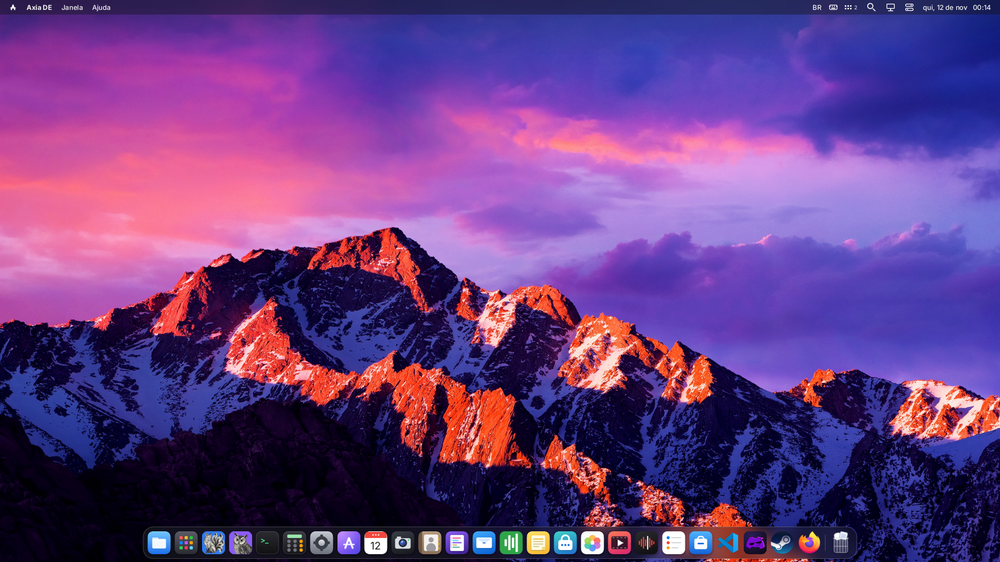
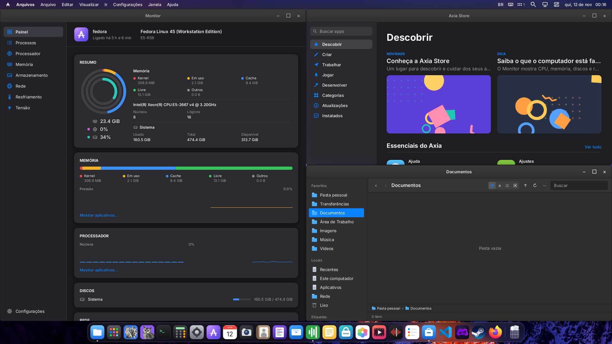

<div align="center">


# Axia DE

**A fast, modern Wayland desktop for Fedora, being rewritten in Rust.**

Its own compositor, window manager, shell and native apps: one coherent desktop that runs on top
of the distribution you already have.

[](https://github.com/rodolfoaltenrath/Axia-DE/actions/workflows/desktop-fedora.yml)
[](https://copr.fedorainfracloud.org/coprs/djonatanaltenrath/axia-de/)
[](docs/RUST.md)
[](docs/WINDOWS.md)
[](#install)
[](LICENSE)
[](#status)

[English](#english) · [Português](#portugues) · [Español](#espanol)

<br>



<sub>The Axia DE desktop on Fedora 45: menu bar, Dock with native and Linux apps (Steam, VS Code, Firefox).</sub>

<br><br>



<sub>Monitor, the Axia Store and Files, native Rust apps, snapped side by side.</sub>

</div>

---

<a id="english"></a>

## English

Axia DE started as a fork of [LordOS](https://github.com/lordbasex/LordOS) to turn its desktop
environment into a project independent of any distribution. Fedora is the first target. Axia DE
brings the desktop: the Wayland compositor, the window manager, the shell and its apps. The host
distribution keeps the kernel, login, networking, audio and system packages.

### Features

- **Its own Wayland compositor**, with GPU composition (EGL/GLES, dmabuf), multiple displays and
  fractional scaling. X11 apps run through XWayland, started on demand.
- **Window management that stays out of the way**: snapping to halves, quarters and thirds with a
  live preview, Snap Assist, windows that resize together along shared edges, virtual desktops and
  an overview.
- **Native apps written in Rust**: Files, Monitor, the Axia Store, Calculator, Clock, Help,
  Characters, Force Quit and About, drawn straight into the scene, with no web view.
- **Every installed app in one launcher**: native apps, `.desktop` entries, Flatpak and Steam games.
- **Input for everyone**: XKB layouts with dead keys, Korean, Japanese and Chinese input methods,
  touchpad gestures and an on-screen keyboard.
- **A polished shell**: menu bar with app menus, Dock, Control Center, global search, notifications,
  frosted glass, light and dark themes.

### Under the hood

| Part | What it is | Language |
| --- | --- | --- |
| `axia-server` | Wayland compositor, KMS/GPU output, input, XWayland, window dragging | C, moving to Rust module by module |
| `rust/axia-shell` | Window list and snapping, renderer pieces, shadows and glass, input and keymaps, search, launcher, clipboard, native apps | Rust |
| `runtime/`, `sdk/`, `themes/` | The shell's interface: React on QuickJS, rendered by the compositor's own engine | JavaScript (JSX) |
| `apps/` | Native apps (Files, Monitor, Store, Calculator…) | Rust |

Every change is moving the desktop towards Rust: fixes are written in Rust and the C or JavaScript
they touch is rewritten. See [docs/RUST.md](docs/RUST.md) and
[docs/SERVER-RUST-MIGRATION.md](docs/SERVER-RUST-MIGRATION.md).

<a id="install"></a>

### Install

From the [Copr repository](https://copr.fedorainfracloud.org/coprs/djonatanaltenrath/axia-de/),
built by CI from `main`:

```sh
sudo dnf copr enable djonatanaltenrath/axia-de
sudo dnf install axia-de
```

Log out and pick the **Axia DE** session in your login manager. Installing adds `axia-session`, the
files under `/usr/libexec/axia` and the session entry. It enables no service and doesn't replace
your login manager. Run the desktop as your regular user, **without sudo**: DRM and evdev access
go through libseat with logind or seatd.

### Build from source

```sh
sudo dnf install dnf5-plugins nodejs npm
sudo dnf builddep packaging/rpm/axia-de.spec
npm ci
make -j4
make check
```

Node.js and npm only build the themes; the desktop doesn't need them at runtime. Without the Mesa
development libraries the build falls back to CPU composition.

To inspect an installation without changing your system, or to install from the checkout:

```sh
make install PREFIX=/usr DESTDIR="$PWD/build/stage"   # staged
sudo make install PREFIX=/usr                          # system-wide
```

A headless start, for testing from the checkout (it doesn't open a window inside GNOME or KDE):

```sh
cd server
./build/axia-server --headless 800x600 --timeout 2
```

In a physical session, `Ctrl+Alt+Backspace` ends it and `Ctrl+Alt+F1`…`F10` switch TTYs.

#### Local RPM

```sh
sudo dnf install rpm-build
cargo xtask srpm --outdir build/srpm
rpmbuild --rebuild --define "_topdir $PWD/build/rpmbuild" build/srpm/*.src.rpm
```

The source archive includes the themes built from the lockfile, and the RPM builds without network
access, with GPU composition.

<a id="status"></a>

### Status

**Experimental.** Axia DE is used daily on Fedora 45 with an AMD GPU, and every commit is built and
tested in a Fedora container by CI. Hardware coverage is still narrow: TTY switching, other GPUs,
suspend and SELinux need more testing. Bug reports are welcome.

### Desktop and OS

The Debian package manager, the OS installer and Imager, the privileged administration helper,
`lord-netd` and `lord-sessiond` are not part of Axia DE. Networking and VPNs, users, SSH, fans and
disk formatting are left to the host system; settings pages that depended on the old helper are
limited. The Store manages `.lpk` apps and offers to open the distribution's software manager when there
is one; RPM and DNF packages are the host's. Audio uses the PulseAudio protocol (PipeWire included); Bluetooth and other integrations
use D-Bus.

See [the extraction's architecture and next steps](docs/STANDALONE.md) (in Portuguese). The
[original documentation](docs/README.md) describes upstream LordOS; its ISO, installation and
administration commands don't apply to Axia DE as they are.

### Repository layout

- `server/`: compositor, graphics engine, app helpers and the `src/platform/` layer.
- `rust/`: the `axia-shell` library linked into the compositor, codecs and build tasks (`cargo xtask`).
- `runtime/`, `sdk/`, `themes/`, `apps/`: the interface and native apps.
- `tools/desktop/`: installation, checks and the source archive for packaging.
- `packaging/desktop/`, `packaging/rpm/`: session integration and the Fedora package.
- `tools/fedora-live/`: an experimental Fedora 44 live ISO with Axia DE as the default session; see
  [FEDORA-LIVE.md](docs/FEDORA-LIVE.md) (in Portuguese).

### Origin and licenses

Axia DE derives from LordOS, developed by iPERFEX; original credits and copyright notices are kept.
See [LICENSE](LICENSE) (MIT) and [THIRD_PARTY.md](THIRD_PARTY.md). Axia DE is not an official LordOS
release and doesn't use the LordOS name, the crown logo or the Lumo mascot, as the LordOS trademark
policy asks of forks.

[English](#english) · [Português](#portugues) · [Español](#espanol)

---

<a id="portugues"></a>

## Português

O Axia DE nasceu como um fork do [LordOS](https://github.com/lordbasex/LordOS) para transformar seu
ambiente de desktop em um projeto independente de distribuição. Fedora é a primeira plataforma. O
Axia DE traz o desktop: o compositor Wayland, o gerenciador de janelas, o shell e seus aplicativos.
A distribuição continua cuidando do kernel, do login, da rede, do áudio e dos pacotes do sistema.

### Recursos

- **Compositor Wayland próprio**, com composição por GPU (EGL/GLES, dmabuf), vários monitores e
  escala fracionária. Aplicativos X11 rodam pelo XWayland, iniciado sob demanda.
- **Gerenciamento de janelas que não atrapalha**: encaixe em metades, quartos e terços com
  pré-visualização, Snap Assist, janelas que se redimensionam juntas pela borda comum, áreas de
  trabalho virtuais e visão geral.
- **Aplicativos nativos em Rust**: Arquivos, Monitor, Axia Store, Calculadora, Relógio, Ajuda,
  Caracteres, Forçar Encerramento e Sobre, desenhados direto na cena, sem web view.
- **Todos os apps instalados em um só lançador**: nativos, entradas `.desktop`, Flatpak e jogos da
  Steam.
- **Entrada para todos**: layouts XKB com teclas mortas, métodos de entrada coreano, japonês e
  chinês, gestos de touchpad e teclado na tela.
- **Um shell caprichado**: barra de menus com os menus do app, Dock, Central de Controle, busca
  global, notificações, vidro fosco, temas claro e escuro.

### Por dentro

| Parte | O que é | Linguagem |
| --- | --- | --- |
| `axia-server` | Compositor Wayland, saída KMS/GPU, entrada, XWayland, arraste de janelas | C, migrando para Rust módulo a módulo |
| `rust/axia-shell` | Lista de janelas e encaixe, partes do renderizador, sombras e vidro, entrada e teclados, busca, lançador, área de transferência, apps nativos | Rust |
| `runtime/`, `sdk/`, `themes/` | A interface do shell: React sobre QuickJS, renderizado pelo motor do próprio compositor | JavaScript (JSX) |
| `apps/` | Apps nativos (Arquivos, Monitor, Store, Calculadora…) | Rust |

Cada mudança leva o desktop em direção ao Rust: correções são escritas em Rust, e o C ou JavaScript
que elas tocam é reescrito. Veja [docs/RUST.md](docs/RUST.md) e
[docs/SERVER-RUST-MIGRATION.md](docs/SERVER-RUST-MIGRATION.md).

### Instalar

Pelo [repositório Copr](https://copr.fedorainfracloud.org/coprs/djonatanaltenrath/axia-de/),
compilado pelo CI a partir da `main`:

```sh
sudo dnf copr enable djonatanaltenrath/axia-de
sudo dnf install axia-de
```

Encerre a sessão e escolha **Axia DE** no gerenciador de login. A instalação adiciona
`axia-session`, os arquivos em `/usr/libexec/axia` e a entrada da sessão. Não habilita serviços nem
substitui o gerenciador de login. Execute o desktop com seu usuário normal, **sem sudo**: o acesso a
DRM e evdev passa pelo libseat com logind ou seatd.

### Compilar a partir do código

```sh
sudo dnf install dnf5-plugins nodejs npm
sudo dnf builddep packaging/rpm/axia-de.spec
npm ci
make -j4
make check
```

Node.js e npm só compilam os temas; o desktop não depende deles em execução. Sem as bibliotecas de
desenvolvimento do Mesa, o build usa composição por CPU.

Para inspecionar uma instalação sem alterar o sistema, ou instalar a partir do checkout:

```sh
make install PREFIX=/usr DESTDIR="$PWD/build/stage"   # em uma pasta
sudo make install PREFIX=/usr                          # no sistema
```

Inicialização sem monitor, para testes no checkout (não abre janela dentro do GNOME ou do KDE):

```sh
cd server
./build/axia-server --headless 800x600 --timeout 2
```

Na sessão física, `Ctrl+Alt+Backspace` a encerra e `Ctrl+Alt+F1`…`F10` trocam de TTY.

#### RPM local

```sh
sudo dnf install rpm-build
cargo xtask srpm --outdir build/srpm
rpmbuild --rebuild --define "_topdir $PWD/build/rpmbuild" build/srpm/*.src.rpm
```

O arquivo fonte inclui os temas compilados a partir do lockfile, e o RPM compila sem acesso à rede,
com composição por GPU.

### Estado

**Experimental.** O Axia DE é usado no dia a dia no Fedora 45 com GPU AMD, e cada commit é compilado
e testado em contêiner Fedora pelo CI. A cobertura de hardware ainda é pequena: troca de TTY, outras
GPUs, suspensão e SELinux precisam de mais testes. Relatos de problemas são bem-vindos.

### Desktop e sistema operacional

O gerenciador de pacotes Debian, o instalador do SO e o Imager, o helper administrativo
privilegiado, `lord-netd` e `lord-sessiond` não fazem parte do Axia DE. Rede e VPN, usuários, SSH,
ventoinhas e formatação de discos ficam com o sistema hospedeiro; as páginas de configuração que
dependiam do antigo helper têm funções limitadas. A Store administra apps `.lpk` e oferece abrir o
gerenciador de software da distribuição quando houver um; pacotes RPM e DNF são do sistema. O áudio usa o protocolo PulseAudio
(inclusive PipeWire); Bluetooth e outras integrações usam D-Bus.

Veja [a arquitetura da extração e os próximos passos](docs/STANDALONE.md). A
[documentação original](docs/README.md) descreve o LordOS upstream; seus comandos de ISO, instalação
e administração não se aplicam ao Axia DE como estão.

### Estrutura do repositório

- `server/`: compositor, motor gráfico, helpers de apps e a camada `src/platform/`.
- `rust/`: a biblioteca `axia-shell` ligada ao compositor, codecs e tarefas de build (`cargo xtask`).
- `runtime/`, `sdk/`, `themes/`, `apps/`: a interface e os apps nativos.
- `tools/desktop/`: instalação, verificações e o arquivo fonte para empacotamento.
- `packaging/desktop/`, `packaging/rpm/`: integração da sessão e o pacote Fedora.
- `tools/fedora-live/`: uma ISO live experimental do Fedora 44 com o Axia DE como sessão padrão;
  veja [FEDORA-LIVE.md](docs/FEDORA-LIVE.md).

### Origem e licenças

O Axia DE deriva do LordOS, desenvolvido pela iPERFEX; créditos e avisos de copyright originais são
mantidos. Veja [LICENSE](LICENSE) (MIT) e [THIRD_PARTY.md](THIRD_PARTY.md). O Axia DE não é uma
versão oficial do LordOS e não usa o nome LordOS, o logo da coroa nem o mascote Lumo, como a
política de marca do LordOS pede aos forks.

[English](#english) · [Português](#portugues) · [Español](#espanol)

---

<a id="espanol"></a>

## Español

Axia DE nació como un fork de [LordOS](https://github.com/lordbasex/LordOS) para convertir su entorno
de escritorio en un proyecto independiente de cualquier distribución. Fedora es la primera
plataforma. Axia DE aporta el escritorio: el compositor Wayland, el gestor de ventanas, el shell y
sus aplicaciones. La distribución se encarga del kernel, el inicio de sesión, la red, el audio y los
paquetes del sistema.

### Funciones

- **Compositor Wayland propio**, con composición por GPU (EGL/GLES, dmabuf), varias pantallas y
  escalado fraccionario. Las aplicaciones X11 funcionan con XWayland, iniciado bajo demanda.
- **Gestión de ventanas que no estorba**: acoplado en mitades, cuartos y tercios con vista previa,
  Snap Assist, ventanas que se redimensionan juntas por el borde común, escritorios virtuales y
  vista general.
- **Aplicaciones nativas en Rust**: Archivos, Monitor, Axia Store, Calculadora, Reloj, Ayuda,
  Caracteres, Forzar salida y Acerca de, dibujadas directamente en la escena, sin web view.
- **Todas las aplicaciones instaladas en un solo lanzador**: nativas, entradas `.desktop`, Flatpak y
  juegos de Steam.
- **Entrada para todos**: distribuciones XKB con teclas muertas, métodos de entrada coreano, japonés
  y chino, gestos de touchpad y teclado en pantalla.
- **Un shell cuidado**: barra de menús con los menús de la aplicación, Dock, Centro de control,
  búsqueda global, notificaciones, vidrio esmerilado, temas claro y oscuro.

### Por dentro

| Parte | Qué es | Lenguaje |
| --- | --- | --- |
| `axia-server` | Compositor Wayland, salida KMS/GPU, entrada, XWayland, arrastre de ventanas | C, migrando a Rust módulo a módulo |
| `rust/axia-shell` | Lista de ventanas y acoplado, partes del renderizador, sombras y vidrio, entrada y teclados, búsqueda, lanzador, portapapeles, aplicaciones nativas | Rust |
| `runtime/`, `sdk/`, `themes/` | La interfaz del shell: React sobre QuickJS, renderizado por el motor del propio compositor | JavaScript (JSX) |
| `apps/` | Aplicaciones nativas (Archivos, Monitor, Store, Calculadora…) | Rust |

Cada cambio lleva el escritorio hacia Rust: las correcciones se escriben en Rust y el C o JavaScript
que tocan se reescribe. Consulta [docs/RUST.md](docs/RUST.md) y
[docs/SERVER-RUST-MIGRATION.md](docs/SERVER-RUST-MIGRATION.md).

### Instalar

Desde el [repositorio Copr](https://copr.fedorainfracloud.org/coprs/djonatanaltenrath/axia-de/),
compilado por la CI a partir de `main`:

```sh
sudo dnf copr enable djonatanaltenrath/axia-de
sudo dnf install axia-de
```

Cierra la sesión y elige **Axia DE** en el gestor de inicio de sesión. La instalación añade
`axia-session`, los archivos en `/usr/libexec/axia` y la entrada de la sesión. No habilita servicios
ni sustituye el gestor de inicio de sesión. Ejecuta el escritorio con tu usuario habitual,
**sin sudo**: el acceso a DRM y evdev pasa por libseat con logind o seatd.

### Compilar desde el código

```sh
sudo dnf install dnf5-plugins nodejs npm
sudo dnf builddep packaging/rpm/axia-de.spec
npm ci
make -j4
make check
```

Node.js y npm solo compilan los temas; el escritorio no depende de ellos en ejecución. Sin las
bibliotecas de desarrollo de Mesa, la compilación usa composición por CPU.

Para inspeccionar una instalación sin modificar el sistema, o instalar desde el checkout:

```sh
make install PREFIX=/usr DESTDIR="$PWD/build/stage"   # en una carpeta
sudo make install PREFIX=/usr                          # en el sistema
```

Inicio sin pantalla, para pruebas desde el checkout (no abre una ventana dentro de GNOME o KDE):

```sh
cd server
./build/axia-server --headless 800x600 --timeout 2
```

En la sesión física, `Ctrl+Alt+Backspace` la termina y `Ctrl+Alt+F1`…`F10` cambian de TTY.

#### RPM local

```sh
sudo dnf install rpm-build
cargo xtask srpm --outdir build/srpm
rpmbuild --rebuild --define "_topdir $PWD/build/rpmbuild" build/srpm/*.src.rpm
```

El archivo fuente incluye los temas compilados a partir del lockfile, y el RPM se compila sin acceso
a la red, con composición por GPU.

### Estado

**Experimental.** Axia DE se usa a diario en Fedora 45 con una GPU AMD, y la CI compila y prueba cada
commit en un contenedor Fedora. La cobertura de hardware todavía es reducida: el cambio de TTY, otras
GPU, la suspensión y SELinux necesitan más pruebas. Los informes de errores son bienvenidos.

### Escritorio y sistema operativo

El gestor de paquetes Debian, el instalador del SO y el Imager, el helper de administración
privilegiado, `lord-netd` y `lord-sessiond` no forman parte de Axia DE. La red y las VPN, los
usuarios, SSH, los ventiladores y el formateo de discos quedan a cargo del sistema anfitrión; las
páginas de configuración que dependían del antiguo helper tienen funciones limitadas. La Store
gestiona aplicaciones `.lpk` y ofrece abrir el gestor de software de la distribución cuando lo hay; los
paquetes RPM y DNF son del sistema. El
audio usa el protocolo PulseAudio (incluido PipeWire); Bluetooth y otras integraciones usan D-Bus.

Consulta [la arquitectura de la extracción y los próximos pasos](docs/STANDALONE.md) (en portugués).
La [documentación original](docs/README.md) describe LordOS upstream; sus comandos de ISO,
instalación y administración no se aplican a Axia DE tal como están.

### Estructura del repositorio

- `server/`: compositor, motor gráfico, helpers de aplicaciones y la capa `src/platform/`.
- `rust/`: la biblioteca `axia-shell` enlazada al compositor, códecs y tareas de compilación
  (`cargo xtask`).
- `runtime/`, `sdk/`, `themes/`, `apps/`: la interfaz y las aplicaciones nativas.
- `tools/desktop/`: instalación, comprobaciones y el archivo fuente para empaquetado.
- `packaging/desktop/`, `packaging/rpm/`: integración de la sesión y el paquete Fedora.
- `tools/fedora-live/`: una ISO live experimental de Fedora 44 con Axia DE como sesión
  predeterminada; consulta [FEDORA-LIVE.md](docs/FEDORA-LIVE.md) (en portugués).

### Origen y licencias

Axia DE deriva de LordOS, desarrollado por iPERFEX; se conservan los créditos y avisos de copyright
originales. Consulta [LICENSE](LICENSE) (MIT) y [THIRD_PARTY.md](THIRD_PARTY.md). Axia DE no es una
versión oficial de LordOS y no usa el nombre LordOS, el logo de la corona ni la mascota Lumo, como
pide a los forks la política de marca de LordOS.

[English](#english) · [Português](#portugues) · [Español](#espanol)
