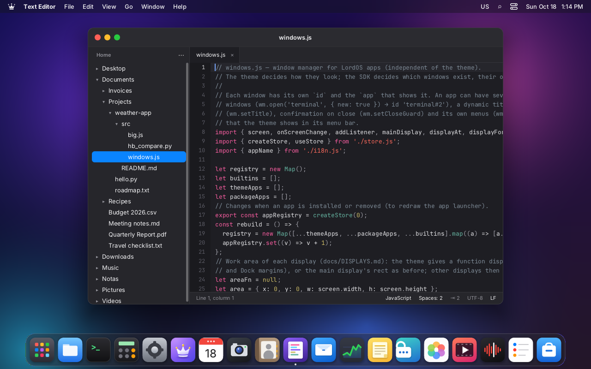
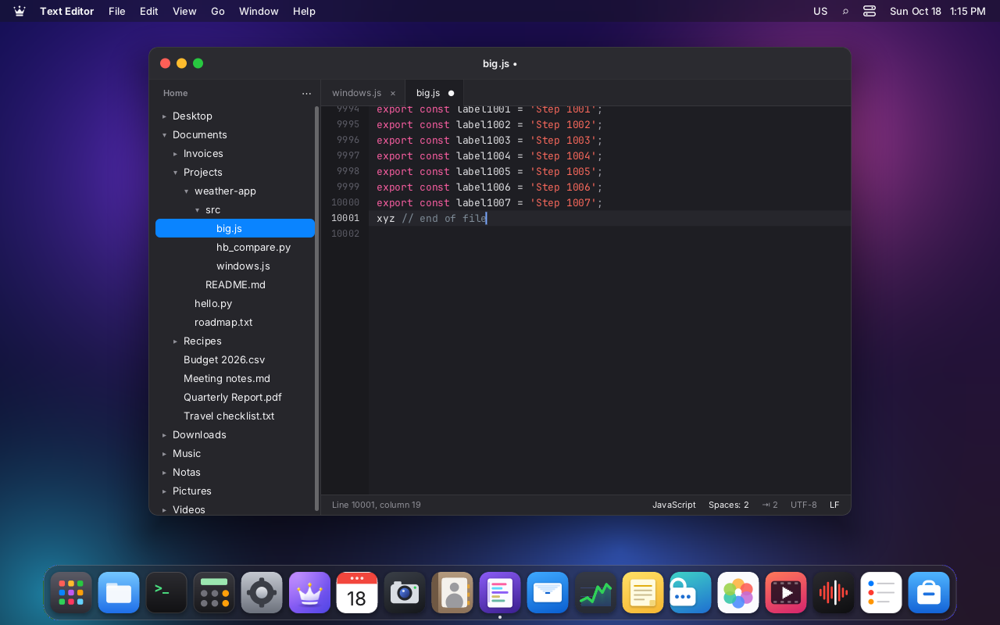
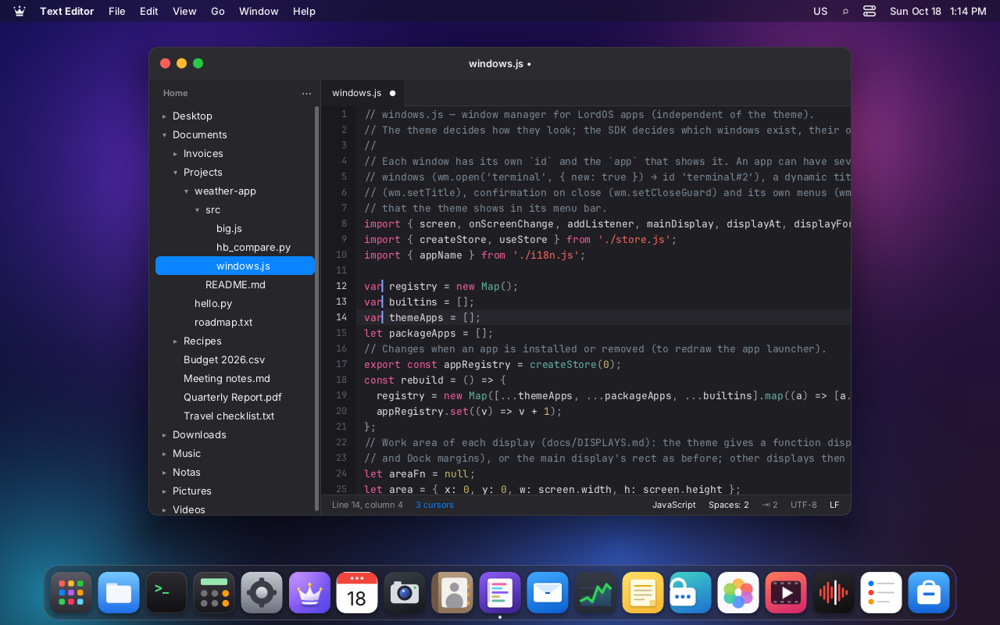
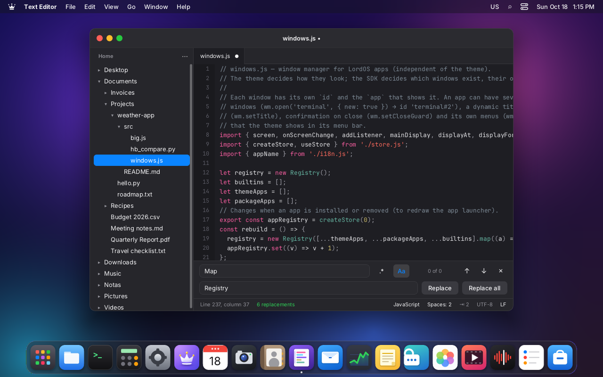
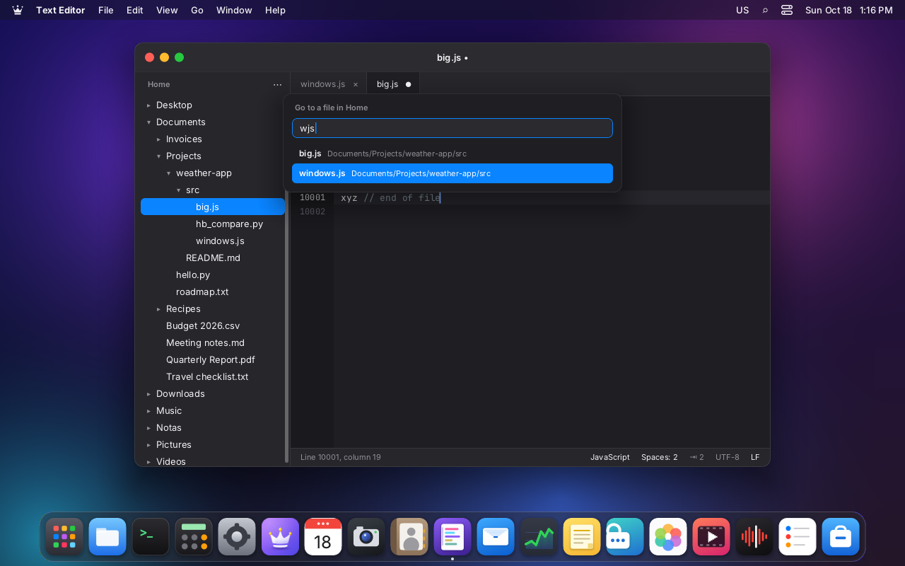
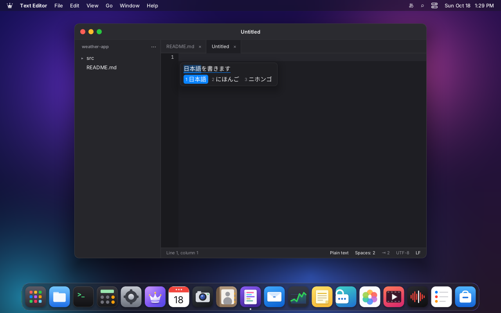
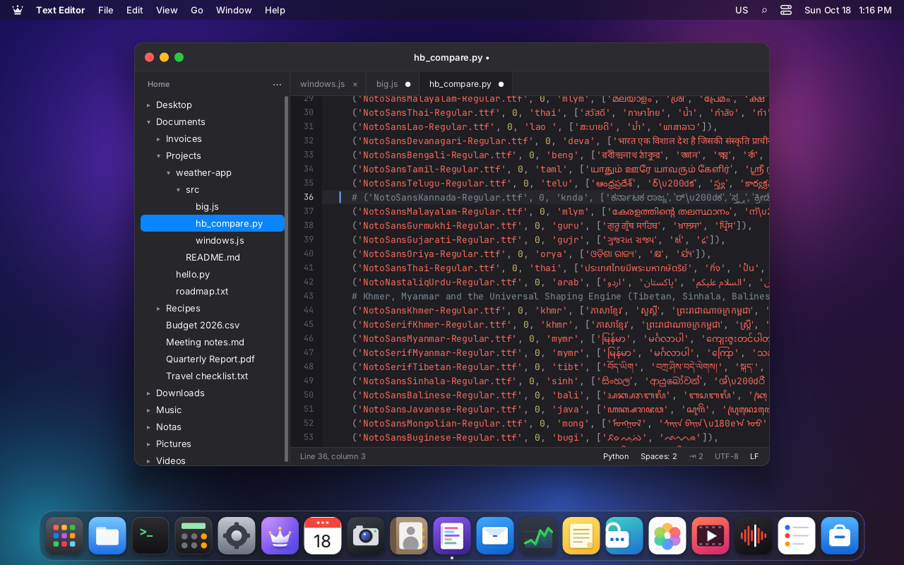
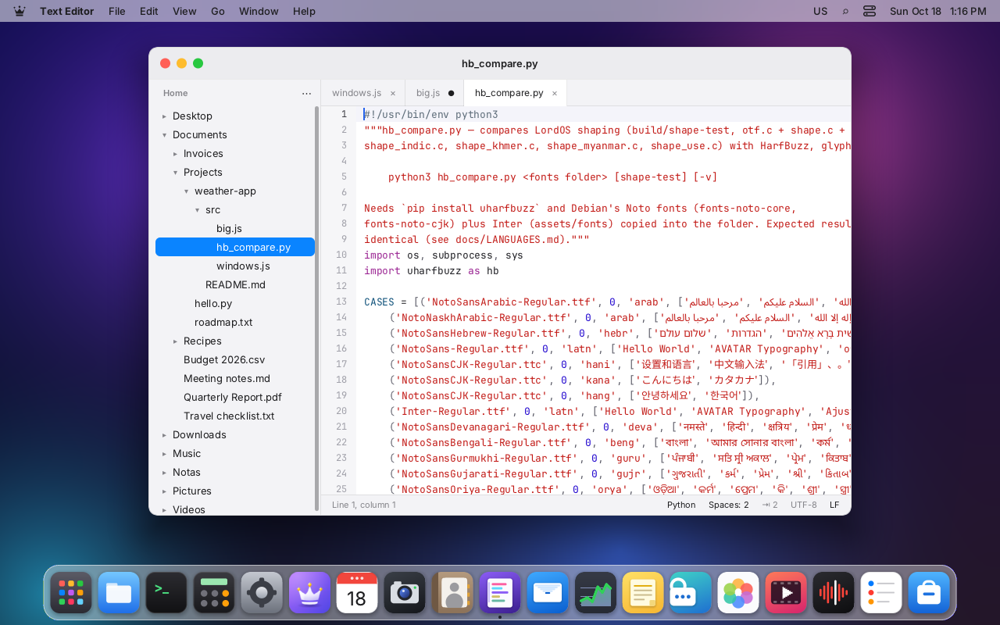
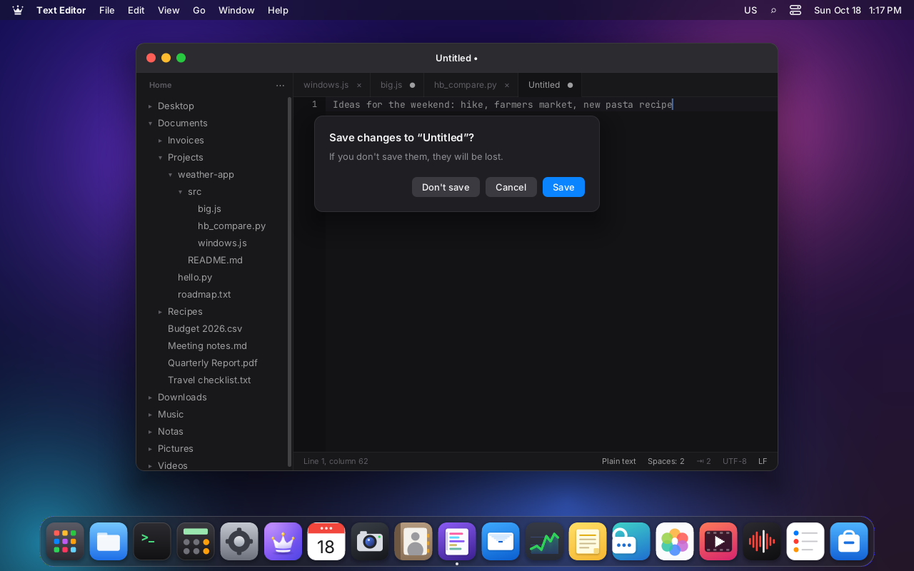
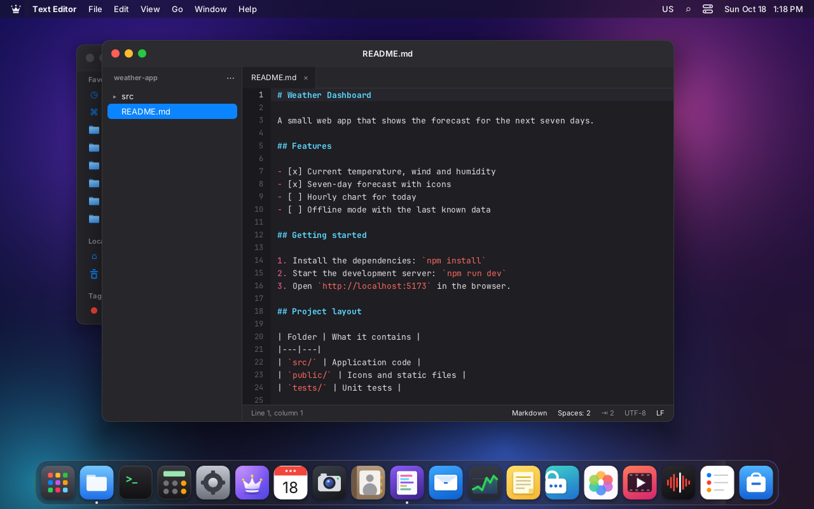

# Text Editor

The desktop's own code editor, TextMate-style (`apps/editor`). It is a compiled Rust app mounted
in the native view host: it doesn't use CodeMirror or Monaco, nor vendored TextMate grammars. The
screenshots below are of the earlier React version, whose layout the Rust window keeps.

| | |
|---|---|
|  |  |
| Project on the left, tabs and highlighting (JavaScript) | A 10,001-line file, at the end and editing |
|  |  |
| Several cursors with ❖D: one word edited on several lines at once | Find and replace all (case-sensitive): «Map» → «Registry» |
|  |  |
| ❖T: open a project file by letters in order («wjs» → windows.js) | Japanese with LordOS's input method: 日本語を書きます |
|  |  |
| Python: comment, duplicate and move line; Indic scripts use the font fallback | Light mode (classic IDE-style palette) |
|  |  |
| Closing with unsaved changes | Double click in Files: the editor opens it, with the folder as the project |

## What it has

- **Window:**
  - the project on the left: the folder tree (by default the home folder, or the folder of the
    first file opened); pick another with «…» or ❖⇧O; ❖\ hides it;
  - tabs with a dot when there are unsaved changes;
  - the status bar: line and column, number of cursors and of selected characters, the language
    (changed with a click), spaces or tabs (click to toggle) and the width (2, 4 or 8), UTF-8 and
    LF or CRLF line endings (click to toggle).
- **Editing:**
  - Enter keeps the indentation and adds one after `{ [ ( :`; between `{}` it puts the closing
    brace on its own line;
  - Tab and ⇧Tab: indent or outdent the selected lines;
  - backspace in a space indentation goes back to the previous tab stop;
  - automatic pairs `() [] {} "" '' ```; typing the closing one skips over it; with a selection,
    it wraps it;
  - undo and redo grouped by word, like TextMate; undoing back to the saved state removes the
    tab's dot.
- **Multiple cursors:** ⌥click adds one; ❖D or Ctrl+D selects the word and then the next equal
  occurrence, each with its cursor; Esc goes back to one; ⌥drag selects by columns. Copying and
  pasting with several cursors hands one line to each cursor.
- **Find and replace** (❖F): text or regex (`.*`), case-sensitive or not (`Aa`), count and
  position («2 of 7»), next or previous (Enter, ⇧Enter, ❖G, ❖⇧G), replace and replace all (a
  single undo step). With regex, the replacement understands `$1`.
- **Jumps:** ❖L go to line (`120` or `120:8`); ❖T open a project file by letters in order, as in
  TextMate (↑ and ↓ choose).
- **Files:** ❖N new, ❖O open (own dialog), ❖S save, ❖⇧S save as, ❖W close tab. From Files, a
  double click on a file that isn't an image, sound, video or archive opens it here
  (`wm.open('editor', { args: { path } })`). Closing the window or a tab with changes asks first.
  It rejects binary files and files larger than 8 MB.
- **App menus** (in the theme's menu bar): File, Edit, View and Go, with their shortcuts.
- **Input methods:** while the text has the keyboard the editor asks for the input method, so
  Japanese, Chinese and Korean type at the cursor (the composition and the candidates show up
  there).
- **Its own icon:** a sheet with colored lines of code.

## Shortcuts

❖ is the Super key; almost all of them also work with Ctrl.

| Shortcut | What it does |
|---|---|
| ❖N / ❖O / ❖⇧O | new, open file, open folder as project |
| ❖S / ❖⇧S / ❖W | save, save as, close tab |
| ❖Z / ❖⇧Z (Ctrl+Y) | undo, redo |
| ❖X / ❖C / Ctrl+V | cut, copy, paste (without a selection: the whole line) |
| ❖A / ❖⇧L | select all, select line |
| ❖D / ⌥click / Esc | next occurrence with another cursor, add cursor, single cursor |
| ❖/ | comment or uncomment (depending on the language: `//`, `#`, `--`, `<!-- -->`…) |
| ❖⇧D | duplicate line |
| ⌥↑ / ⌥↓ | move line |
| ❖] / ❖[ · Tab / ⇧Tab | indent, outdent |
| Ctrl+← / Ctrl+→ (also ⌥) | previous or next word (with ⇧, selects) |
| Home / End | start of the line's text (again: column 0), end of line |
| Ctrl+Home / Ctrl+End, ❖↑ / ❖↓ | start or end of the file |
| PgUp / PgDn | one screen |
| ❖F / ❖G / ❖⇧G | find and replace, next, previous |
| ❖L / ❖T | go to line, go to a project file |
| ❖\ | show or hide the project |
| Ctrl+Tab / Ctrl+⇧Tab | next or previous tab |

Mouse: click places the cursor, dragging selects, double click selects the word (and dragging
continues by words), triple click the line, ⇧click extends, the wheel scrolls (with ⇧,
sideways).

## Highlighting

It is our own state-based tokenizer (`apps/editor/syntax.rs`):
- each language is a list of rules (pattern, type, next state); the few look-aheads are a second
  pattern that must or must not follow;
- it tokenizes line by line, and the state at the end of a line (inside a `/* */` comment, a
  Python `"""` or a JS template) carries over to the next;
- when editing, it re-tokenizes from the first changed line and only what is visible.

Languages: JavaScript, JSX and TypeScript; C and C++; Python; Go; Rust; Shell (also Makefile and
Dockerfile); JSON; Markdown; HTML, XML and SVG; CSS, SCSS and Less; YAML; PHP; SQL; INI, TOML and
`.desktop`; diff and patch; plain text. The language comes from the extension, and can also be
chosen in the status bar. The colors are a classic TextMate/IDE-style palette, dark or light depending
on the theme's mode.

## How it's built

| File | What it owns |
|---|---|
| `buffer.rs` | lines, cursors (head and anchor), transactions with their inverse, undo and redo |
| `edit.rs` | typing, indentation, comments, line commands, movement, the clipboard, the keyboard map |
| `syntax.rs` | the languages, the tokenizer and the colors |
| `search.rs` | find and replace, and the score of Go to File |
| `files.rs` | confined reading, atomic writing, folder listing and the walk of Go to File |
| `mod.rs`, `ui.rs` | the window: tabs, project, pointer, dialogs, menus; the widget trees |

Only the visible lines (plus 6 above and 6 below) and the visible project rows are drawn. The
list of Go to File is walked on a worker thread.

Positions count characters. Disk access follows the rules of the desktop's file service
(`axia_fs::policy`): the home folder and the mounted disks, never the protected files and
folders; writing is atomic, keeps the permissions and refuses links and special files; up to
32 MB. The shared services only run what Rust asks for: the file dialog (`files.pick`, which now
opens, saves and picks folders), `windows.menus`, `windows.events`, `windows.closeGuard`,
`windows.close`, `print.open` and the input method.

Tests: `cargo test -p axia-app-editor` (document, commands, tokenizer, search, and the window
against the job protocol with a scratch home). During the port the tokenizer was compared with the
JavaScript one on about 200,000 lines of this repository and the document with 10,000 random
operations.

## Differences from the React version

- Redoing a run of typed characters now restores it; before, `abc`, undo, redo gave `acb`.
- SQL keywords are recognized in any case (`Select`), as intended.
- Files that are not valid UTF-8 are refused like binary files, so saving cannot corrupt them.
- Regex search uses the Rust `regex` syntax: no look-around and no backreferences (the bar shows
  "invalid regex"). Replacements keep `$1`, `$&`, `$<name>` and `$$`.
- Closing a window with several unsaved documents asks about each in turn, and "Save" on an
  untitled one closes it after the file dialog.
- Hiding and showing the project keeps the chosen folder.

Performance has not been measured again, and the window still needs the graphical check on a
desktop (pointer selection, input method, light and dark).

## Pending

- Soft wrap, code folding and a minimap.
- TextMate `.tmLanguage` grammars, bundles and snippets with tab stops.
- Find in the whole project.
- Encodings other than UTF-8.
- Remembering open files between sessions.
- Text drag and drop.
